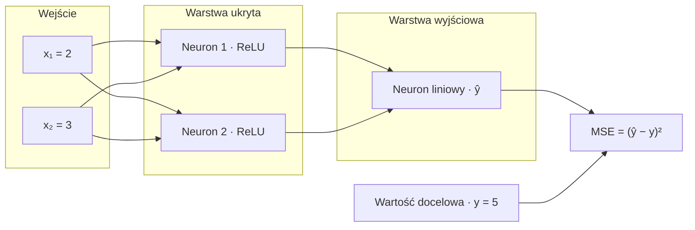

# Zadanie domowe

## Konfiguracja

1. **Zainstaluj Git**
   Instrukcja instalacji: [https://github.com/git-guides/install-git](https://github.com/git-guides/install-git)

2. **Zainstaluj `uv`**
   `uv` to narzędzie do zarządzania środowiskiem i uruchamiania skryptów w projekcie.

```bash
pip install uv
```

Instrukcja instalacji: [https://docs.astral.sh/uv/getting-started/installation/#standalone-installer](https://docs.astral.sh/uv/getting-started/installation/#standalone-installer)

---

## Inicjalizacja projektu

1. **Sklonuj repozytorium**

```bash
git clone <url>
```

2. **Utwórz nowy branch**

```bash
git checkout -b <nazwa_brancha>
```

3. **Stwórz środowisko wirtualne i zsynchronizuj zależności**

```bash
uv sync
```

4. **Uruchom kod treningowy**

```bash
uv run python -m src.train
```

5. **Uruchom testy jednostkowe**

```bash
uv run python -m pytest
```

Ustawienia treningu znajdziesz w pliku [`src/config/config.yaml`](src/config/config.yaml).

## Zadanie programistyczne

1. **Podziel dane i przeprowadź analizę.** Ustaw ziarno losowości (`seed`) i utwórz zbiór treningowy oraz walidacyjny. Podaj liczbę obserwacji w obu zbiorach. Na zbiorze treningowym pokaż histogram zmiennej `Calories` oraz jej zależność od każdej z siedmiu cech wejściowych. Pomiń kolumnę `id`. Wskaż, które cechy wydają się pomocne w predykcji, i uzasadnij wybór na podstawie wykresów.
2. **Przygotuj dane do treningu.** Wyjaśnij ograniczenia normalizacji min–max w kodzie startowym i zastąp ją standaryzacją. Średnią i odchylenie standardowe wyznacz na zbiorze treningowym. Tych samych wartości użyj do przekształcenia danych walidacyjnych i danych wejściowych podczas predykcji.
3. **Zabezpiecz predykcje przed wartościami ujemnymi.** Wyjaśnij, dlaczego model startowy może zwracać ujemne wartości i co to oznacza dla obliczania RMSLE oraz z punktu widzenia logiki problemu predykcji kalorii. Zaproponuj rozwiązanie, uzasadnij je i zastosuj przed treningiem modelu bazowego oraz wszystkich wariantów.
4. **Porównaj modele.** Jako punktu odniesienia użyj dostarczonej architektury z zabezpieczeniem z punktu 3, trenowanej przez SGD z momentum i bez Dropout. Oprócz modelu bazowego przygotuj cztery warianty. W każdym wprowadź jedną z poniższych zmian:

   - zmień rozmiar jednej warstwy ukrytej,
   - zastąp SGD z momentum optymalizatorem Adam,
   - dodaj Dropout,
   - użyj podzbioru cech i uzasadnij jego wybór na podstawie analizy zbioru treningowego.

   Zachowaj ten sam podział danych, ziarno losowości, liczbę epok i rozmiar partii. W wariantach z SGD użyj tego samego współczynnika uczenia co w modelu bazowym. Podaj współczynnik uczenia i pozostałe ustawienia każdego wariantu, w tym prawdopodobieństwo zerowania w warstwach Dropout. Dla wszystkich pięciu modeli podaj treningowe i walidacyjne RMSLE obliczone w trybie `model.eval()`. Wskaż model z najniższym walidacyjnym RMSLE i krótko zinterpretuj wyniki.
5. **Przygotuj skrypt predykcyjny.** Wygeneruj plik `submission.csv` z nagłówkiem `id,Calories` i jedną predykcją dla każdego rekordu ze zbioru testowego.

**Do oddania**

- Kod rozwiązania, w tym skrypt treningowy i skrypt predykcyjny.
- Krótki raport z wykresami, tabelą wyników RMSLE i wnioskami z porównań.
- Plik `submission.csv` z predykcjami dla zbioru testowego oraz rzesłanie pliku na Kaggle.

## Zadanie teoretyczne

### 1. Pochodne parametrów sieci

Oblicz pochodne funkcji straty względem wszystkich wag i wyrazów wolnych w sieci przedstawionej na schemacie. Każda strzałka prowadząca do neuronu oznacza osobną wagę. Każdy neuron ma własny wyraz wolny.



- Czy sieć może się uczyć, jeśli wszystkie wagi i wyrazy wolne zostaną zainicjalizowane zerami? Wskaż, które parametry mogą się wtedy zmienić. W obliczeniach przyjmij `ReLU′(0) = 0`.
- Oblicz pochodne dla przypadku, w którym wszystkie wagi i wyrazy wolne są początkowo równe 1.

### 2. Pytania

1. W jakich zadaniach warto rozważyć użycie sieci neuronowej? Jakie ograniczenia miałby program, który przewiduje wartości wyłącznie na podstawie ręcznie zapisanych reguł, takich jak „jeśli `x1 = 5` i `x2 = 1`, zwróć `5.6`”?
2. Do czego służą funkcje aktywacji? Co się stanie, jeśli usuniesz je z sieci o wielu warstwach ukrytych?
3. W jakim celu używane są funkcje aktywacji? Co się stanie jeśli w sieci o wielu warstwach ukrytych pozbędziemy się funkcji aktywacji?
4. Jak poradzić sobie z brakującymi wartościami cech w części rekordów zbioru treningowego?
